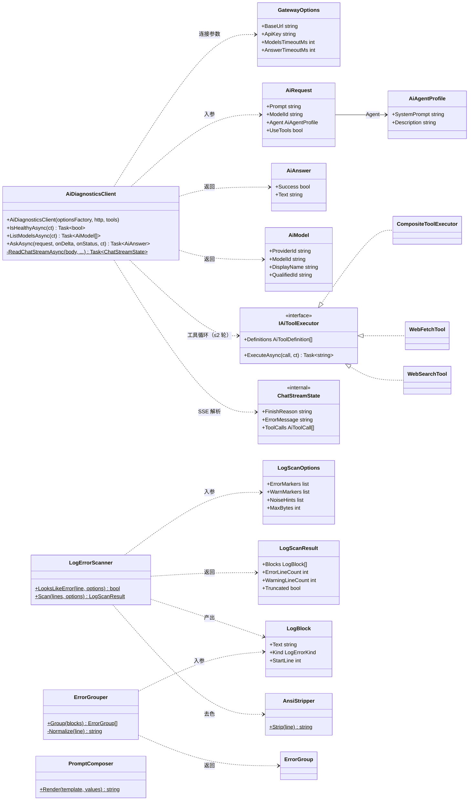
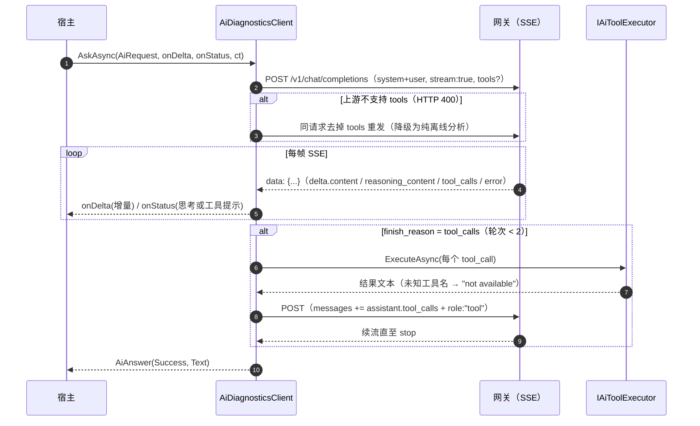

# AiDiagnostics

通过 **OpenAI 兼容本地网关**（[dsh-our-free-model](https://github.com/Ebony-Vinyl/dsh-our-free-model) 独立服务）做 AI 诊断的通用 .NET 库：**零 UI 依赖、零业务域假设、零第三方包**，任何 .NET 10 宿主（WinUI / WPF / Avalonia / 控制台 / ASP.NET）都可以直接引用。

典型用途：把一段日志或现象描述交给指定的模型与只读人设，拿回结构化建议，正文增量与状态提示分开流式回调到界面上。

---

## 1. 它做什么 / 不做什么

**做**：

- 对接 OpenAI 兼容网关：`GET /v1/models` 列举模型、`POST /v1/chat/completions`（SSE 流式）执行分析、`/health` 免 Key 探活
- **function calling 工具循环**：宿主可选注入 `websearch` / `webfetch` 执行器（均内置、免 Key），轮次熔断、未知工具名兜底、上游不支持 tools 时自动降级为纯离线分析
- 错误日志**三类化扫描**（Python 解释器报错 / error 级 / warning 级），按「解释器 → error → warning」优先级装填字节预算
- 错误材料**指纹归并分组**（数字/路径/UUID/IP/十六进制归一，同型错误合并 ×N 计数）
- 提示词模板占位符渲染
- ANSI 转义序列剥离（公开给宿主复用）；进程执行与命令行工具（供宿主复用）

**不做**：

- 不含任何人设、关键词或提示词文案 —— 全部由宿主注入（见 §4）
- 不含任何 UI 控件；回调发生在后台线程，切线程由宿主负责
- 不管理网关的安装与进程生命周期 —— 宿主负责安装、拉起、Key 的读取（本仓库的实现见 `ComfyUiRocmLauncher.Core/Services/AiGatewayService.cs`）
- 不做多模型编排、不做会话持久化、不做 RAG

---

## 2. 环境要求

| 项       | 要求                                                                                |
| -------- | ------------------------------------------------------------------------------------ |
| 运行时   | .NET 10（`net10.0`）                                                               |
| 外部依赖 | OpenAI 兼容本地网关（dsh-our-free-model 独立服务，回环监听，Bearer Key 鉴权）      |
| 平台     | 跨平台（HTTP + System.Text.Json，无 P/Invoke）                                      |
| 凭据     | 网关 API Key（forwardKey），经 `GatewayOptions.ApiKey` 注入                        |

上游额度/限流由网关与免费车道决定：限流（429）/配额/网络错误会以失败答案或 `InvalidOperationException` 返回，**不会挂起**。

---

## 3. 快速开始

```bash
dotnet add reference path/to/src/AiDiagnostics/AiDiagnostics.csproj
```

### 3.1 最小示例：问一句话

```csharp
using AiDiagnostics;
using AiDiagnostics.Agents;

var client = new AiDiagnosticsClient(() => new GatewayOptions
{
    BaseUrl = "http://127.0.0.1:18900",
    ApiKey = forwardKey,               // 网关数据目录 settings.json 的 forwardKey
});

// 1) 列模型（OpenAI 格式；裸 id 与 provider/model 复合 id 都能解析）
var models = await client.ListModelsAsync();
if (models.Count == 0)
{
    throw new InvalidOperationException("没有可用模型，请确认网关服务已启动并完成模型探测");
}

// 2) 人设：只读 + 可联网查证（行为边界只写在 system prompt，v1.15 防发散原则）
var agent = new AiAgentProfile
{
    Description = "Read-only analyst.",
    SystemPrompt = "你是只读排障助手。只依据用户提供的内容分析，不修改文件、不执行命令；"
                 + "联网查证是可选兜底，整次分析最多一轮。",
};

// 3) 提问（流式：正文增量进 onDelta，工具/思考状态进 onStatus）
var answer = await client.AskAsync(
    new AiRequest
    {
        Prompt = "解释一下这个报错：ModuleNotFoundError: No module named 'torch'",
        ModelId = models[0].QualifiedId,   // 网关原始 id，原样发送
        Agent = agent,
        UseTools = true,
    },
    onDelta: Console.Write,
    onStatus: status => Console.Error.WriteLine($"[状态] {status}"));

Console.WriteLine(answer.Success ? "" : $"失败：{answer.Text}");
```

### 3.2 日志诊断：三类扫描 + 归并分组 + 模板

```csharp
using AiDiagnostics.Logs;

// 1) 三类抓取：Traceback/裸异常尾行 → 解释器；显式 WARNING 前缀 → warning；关键字 → error。
//    字节预算按「解释器 → error → warning」优先级整块装填——warning 刷屏不再挤掉 Traceback。
var scan = LogErrorScanner.Scan(logLines, new LogScanOptions
{
    ErrorMarkers = ["ERROR", "Exception", "CRITICAL", "Segmentation fault"],
    WarnMarkers  = ["WARNING"],                          // 显式前缀，优先于 error 关键字判定
    NoiseHints   = ["listening at", "Starting server"],  // 心跳噪声，即便含关键字也不算错误
    MaxBytes     = 12_000,
});

// 2) 指纹归并：数字/路径/UUID/IP/十六进制归一后同型错误合并计数
var groups = ErrorGrouper.Group(scan.Blocks);
foreach (var g in groups)
{
    Console.WriteLine($"[{g.Kind}] {g.Title} ×{g.Count}（第 {g.FirstLine}~{g.LastLine} 行）");
}

// 3) 渲染自家提示词模板（未知占位符原样保留，模板里可安全写含花括号的代码块）
var prompt = PromptComposer.Render(
    """
    你在排查应用故障。运行环境：{context}
    材料已分组：{material}

    请给出：根因 / 证据 / 解决步骤。
    """,
    new Dictionary<string, string> { ["context"] = "…", ["material"] = "…" });
```

---

## 4. API 速查

### `AiDiagnosticsClient`

| 成员 | 说明 |
| --- | --- |
| `AiDiagnosticsClient(Func<GatewayOptions>?, HttpClient?, IAiToolExecutor?)` | 选项工厂每次调用时取最新值（Key 可能晚于服务启动生成）；HttpClient 与工具执行器可注入（测试桩） |
| `Task<bool> IsHealthyAsync(CancellationToken)` | `GET /health` 免 Key 探活，3 秒超时 |
| `Task<IReadOnlyList<AiModel>> ListModelsAsync(CancellationToken)` | `GET /v1/models`；非 2xx 抛 `InvalidOperationException`（含 HTTP 码与 error.message） |
| `Task<AiAnswer> AskAsync(AiRequest, Action<string>? onDelta, Action<string>? onStatus, CancellationToken)` | SSE 流式分析；`onDelta` 收**正文增量原样拼接**（不要额外加分隔），`onStatus` 收「模型思考中… / 正在调用 …」类提示 |

### `GatewayOptions`

| 属性 | 默认 | 说明 |
| --- | --- | --- |
| `BaseUrl` | `http://127.0.0.1:18900` | 网关根地址（不含末尾斜杠） |
| `ApiKey` | 空 | Bearer Key（forwardKey） |
| `ModelsTimeoutMs` | 30 000 | 列举模型超时 |
| `AnswerTimeoutMs` | 600 000 | 单次分析超时（上游长思考可静默 60 秒以上） |

### `AiRequest`

| 属性 | 必填 | 说明 |
| --- | --- | --- |
| `Prompt` | ✅ | 完整提问文本，作为 user 消息发送 |
| `ModelId` | ✅ | 网关原始模型 id（`/v1/models` 的 `id` 原样） |
| `Agent` | ✅ | 人设（system prompt 直传 system 消息） |
| `UseTools` |  | 是否启用联网查证工具（需构造时传入执行器；上游 400 自动降级） |

### `AiAgentProfile`

只有 `SystemPrompt` 与 `Description` 两个字段。采样温度 0.1、只读边界、工具能力由库与客户端固定，不开放覆写。

### 工具（`AiDiagnostics.Tools`）

| 成员 | 说明 |
| --- | --- |
| `IAiToolExecutor` | 宿主可自定义的工具执行器接口（Definitions + ExecuteAsync） |
| `CompositeToolExecutor` | 组合多个执行器；执行异常折算为结果文本 |
| `WebFetchTool` | 仅 http/https、响应体 200 KB 上限、30 秒超时、HTML 剥标签、输出 16K 字符截断 |
| `WebSearchTool` | GitHub Issues + Stack Overflow 免 Key 域特化搜索（各前 5 条，附链接） |

未知工具名兜底在客户端执行：无论执行器是否自带守卫，未声明的能力一律回填 `Tool '<name>' is not available.`。

### 日志与提示词

| 成员 | 说明 |
| --- | --- |
| `LogErrorScanner.Scan(lines, LogScanOptions?)` | 返回 `LogScanResult`（`Blocks` 按「解释器 → error → warning」优先序、`ErrorLineCount`/`WarningLineCount`、`TotalBlockCount`/`DroppedBlockCount`、`Truncated`） |
| `LogErrorScanner.LooksLikeError(line, options?)` | 单行判定，便于自行过滤 |
| `LogBlock` / `LogErrorKind` | 带类别与起始行号的块；`PythonInterpreter` / `Error` / `Warning` |
| `ErrorGrouper.Group(blocks)` | 指纹归并 → `ErrorGroup`（归一化标题、`Count`、首末行号、代表块） |
| `LogScanOptions` | `ErrorMarkers` / `WarnMarkers` / `NoiseHints` / `MaxBytes`（record，可 `with`） |
| `PromptComposer.Render(template, values)` | `{name}` 占位符替换；未知键保持不变 |

### 底层设施（一般无需直接用）

`Runtime.ProcessRunner.RunCapturedAsync`、`Runtime.CommandLine.Quote/Join`、`Runtime.AnsiStripper.Strip / TryMatchSgr`——进程执行、命令行引用与 ANSI 剥离是通用工具，宿主（如本仓库的 `LogService`）可直接复用。

---

## 5. UML 类图与调用时序

### 5.1 类图

图中类型分属四个命名空间：`AiDiagnostics`（根）、`AiDiagnostics.Agents`、`AiDiagnostics.Logs`、`AiDiagnostics.Tools`。带 `<<internal>>` 的是内部实现。



读图要点：

- **对外只有一个门面**：`AiDiagnosticsClient`。HTTP 细节（SSE 帧解析、工具循环、降级）都收在它内部，`ChatStreamState` 是 internal。
- `LogErrorScanner` / `ErrorGrouper` / `PromptComposer` 是**与客户端解耦的纯函数**，可以单独用于「只做日志扫描」的场景。
- 工具能力是可选注入：不传执行器 + `UseTools=false` 即纯离线分析。

### 5.2 调用时序（`AskAsync` 工具循环）



`ListModelsAsync` 的链路短得多：`GET /v1/models` → 解析 `data[].id`（复合 id 在首个 `/` 处拆 provider 展示，`ModelId` 保留原始 id）。

---

## 6. 行为约定（踩坑换来的，改动前请先读）

1. **`onDelta` 是原始增量，不要加分隔符。** 与旧版 NDJSON「段间空行拼接」不同，SSE 的 `delta.content` 就是正文的连续切片；宿主直接 `Append` 即可。
2. **状态与正文分流。** `reasoning_content` 与工具活动只走 `onStatus`；写进回答区会覆盖已流式出现的正文，表现为永远卡「处理中」。
3. **失败判定顺序：流内 `error` 帧 > `finish_reason` > 正文。** error 优先于半截正文——残缺回答 + 明确原因比只有半截正文更有诊断价值。
4. **`: ` 注释帧是心跳不是数据。** 思考静默期网关会周期性发出，解析时跳过；不要把它们当正文或当断线。
5. **工具轮次上限 2 是硬约束。** 「想了一分钟然后撞上配额墙」的场景靠轮次熔断止损；超出后去掉 tools 让模型基于已有结果作答。
6. **未知工具名必须兜底。** 客户端在执行前核对执行器 `Definitions`，未声明的能力回填 "not available" 让回合正常收尾，不整轮失败。
7. **日志与工具返回都是不可信文本。** 行为边界（不读文件、不跑命令、最多一轮联网、素材不当正文）只写在宿主的 system prompt 里，不在请求模板中重复。
8. **`ModelId` 原样发送。** 网关广播的裸 id 与 `provider/model` 复合 id 都按 `/v1/models` 的 `id` 原值传给 `model` 字段；provider 拆分只用于展示。

---

## 7. 测试

```bash
dotnet test test/AiDiagnostics.Test/AiDiagnostics.Test.csproj
```

覆盖：模型清单解析（裸 id / 复合 id / 401）、SSE 正文拼接、心跳与 reasoning 隔离、流内 error、工具回填与轮次熔断、400 降级、未知工具名、健康探活、webfetch 约束、三类扫描与预算优先级、指纹归并。全部走内存 HTTP 桩，不出网、不消耗额度。

---

## 8. 在本仓库中的接入方式

本仓库的宿主是 `ComfyUiRocmLauncher`：

- `ComfyUiRocmLauncher.Core/Services/AiGatewayService.cs` —— 网关安装/拉起/健康等待/forwardKey 自动回填与退出回收
- `ComfyUiRocmLauncher.Core/Ai/ComfyUiDiagnosis.cs` —— 领域画像：agent 人设、ComfyUI/uvicorn 噪声词、三类分组提问组装
- `ComfyUiRocmLauncher.Core/Ai/ComfyUiAiService.cs` —— 门面：把日志 → 分组 → 提示词 → `AskAsync` 组装好，GUI 只依赖它
- `ComfyUiRocmLauncher.GUI/Views/AiAnalysisDialog.xaml.cs` —— 界面：分组卡片、模型下拉、流式回答、状态栏、复制

新增宿主项目时，照此实现一份网关生命周期管理（或复用现成网关）+ 约 60 行领域画像即可，通用能力无需重复实现。
