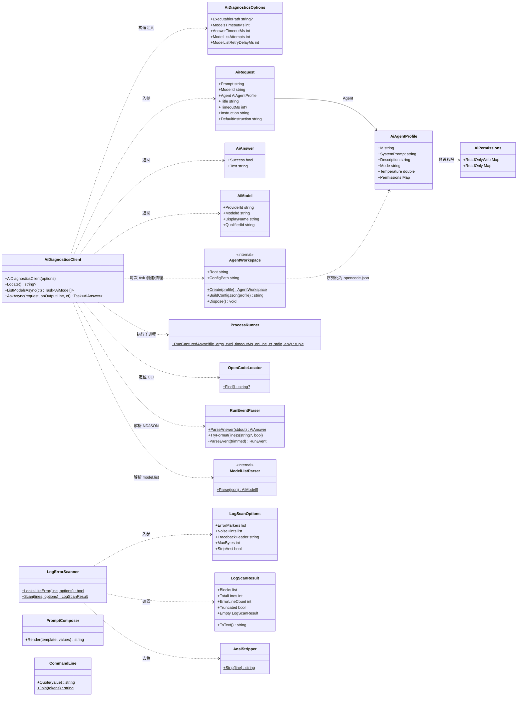
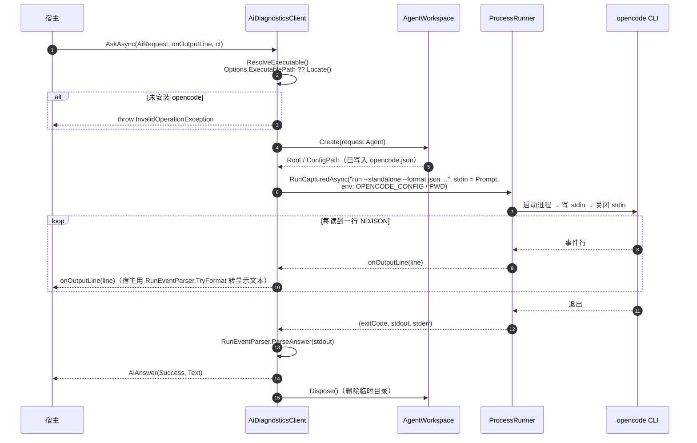

# AiDiagnostics

通过本机 [opencode](https://opencode.ai) CLI 做 AI 诊断的通用 .NET 库：**零 UI 依赖、零业务域假设**，任何 .NET 10 宿主（WinUI / WPF / Avalonia / 控制台 / ASP.NET）都可以直接引用。

典型用途：把一段日志或现象描述交给指定的模型与自定义 agent（只读、可联网查证），拿回结构化建议，并把过程流式显示在界面上。

---

## 1. 它做什么 / 不做什么

**做**：

- 定位本机 opencode CLI（npm 全局 / 用户目录 / PATH，自动绕过 npm 的 shim 脚本）
- 列举当前可用的模型（`provider/model` 形式，可直接喂给 `--model`）
- 按 **agent 画像** 在运行时生成临时 `opencode.json`（人设、权限、温度），分析结束自动清理
- 调 `opencode run --format json`，解析 NDJSON 事件流，逐行回调进度与正文
- 日志错误扫描（关键字 / Traceback 归并 / 字节预算截断，关键词可配置）
- 提示词模板占位符渲染
- 进程执行（stdin 写入、超时、取消、进程树强杀、输出冲刷一次做对）

**不做**：

- 不含任何人设、关键词或提示词文案 —— 全部由宿主注入（见 §4）
- 不含任何 UI 控件；进度回调是 `Action<string>`，切线程由宿主负责
- 不管理 opencode 的登录态（凭据由用户自行执行 `opencode auth login` 配置）
- 不做多模型编排、不做会话持久化、不做 RAG

---

## 2. 环境要求

| 项 | 要求 |
| --- | --- |
| 运行时 | .NET 10（`net10.0`） |
| 外部依赖 | opencode CLI（实测 2.0.18；1.x 不保证兼容） |
| 平台 | Windows 为一等公民（参数引用按 `CommandLineToArgvW` 规则）；进程执行本身跨平台 |
| 凭据 | 宿主或用户事先配置好 provider（`opencode auth login`） |

模型额度由 opencode 账号决定：额度不足时 `AskAsync` 会返回 `Success=false`、正文为上游错误（例如 `provider.quota` / HTTP 402），**不会挂起**。

---

## 3. 快速开始

```bash
dotnet add reference path/to/src/AiDiagnostics/AiDiagnostics.csproj
```

### 3.1 最小示例：问一句话

```csharp
using AiDiagnostics;
using AiDiagnostics.Agents;

var client = new AiDiagnosticsClient();

// 1) 列模型（内部已处理后台服务冷启动重试）
var models = await client.ListModelsAsync();
if (models.Count == 0)
{
    throw new InvalidOperationException("没有可用模型，请先 opencode auth login");
}

// 2) 定义 agent：只读 + 可联网查证
var agent = new AiAgentProfile
{
    Id = "readonly-analyst",
    Description = "Read-only analyst.",
    SystemPrompt = "你是只读排障助手。只依据用户提供的内容分析，不修改文件、不执行命令。",
};

// 3) 提问
var answer = await client.AskAsync(new AiRequest
{
    Prompt = "解释一下这个报错：ModuleNotFoundError: No module named 'torch'",
    ModelId = models[0].QualifiedId,   // 形如 opencode/claude-haiku-5-5
    Agent = agent,
    Title = "依赖排查",
});

Console.WriteLine(answer.Success ? answer.Text : $"失败：{answer.Text}");
```

### 3.2 流式显示（命令行 / 界面通用）

```csharp
var answer = await client.AskAsync(
    new AiRequest { Prompt = prompt, ModelId = model, Agent = agent },
    onOutputLine: line =>
    {
        // 无需自己解析 NDJSON；进度与否由返回值直接告知，不必猜字符串前缀
        var (display, isProgress) = RunEventParser.TryFormat(line);
        if (display is null) return;

        if (isProgress)
        {
            ShowProgress(display);
        }
        else
        {
            AppendBody(display);
        }
    },
    cancellationToken: cts.Token);
```

> WinUI/WPF 宿主记得把回调切回 UI 线程（例如 `DispatcherQueue.TryEnqueue`）；本库的回调发生在后台线程。

### 3.3 日志诊断：扫描 + 模板 + 分析

```csharp
using AiDiagnostics.Logs;

// 1) 只捞 error 行与 Traceback 块，按 12KB 预算截断
var scan = LogErrorScanner.Scan(logLines, new LogScanOptions
{
    ErrorMarkers = ["ERROR", "Exception", "CRITICAL", "Segmentation fault"],
    NoiseHints = ["listening at", "Starting server"],   // 心跳噪声，即便含关键字也不算错误
    MaxBytes = 12_000,
});

// 2) 渲染自家提示词模板（未知占位符原样保留，模板里可安全写含花括号的代码块）
var prompt = PromptComposer.Render(
    """
    你在排查应用故障。
    运行环境：{context}

    ```log
    {log}
    ```

    请给出：根因 / 证据 / 解决步骤。
    """,
    new Dictionary<string, string>
    {
        ["context"] = $"版本 1.2.3，路径 {appDir}",
        ["log"] = scan.ToText(),
    });

var answer = await client.AskAsync(new AiRequest
{
    Prompt = prompt,
    ModelId = model,
    Agent = agent,
});
```

---

## 4. API 速查

### `AiDiagnosticsClient`

| 成员 | 说明 |
| --- | --- |
| `AiDiagnosticsClient(AiDiagnosticsOptions? options = null)` | 构造；选项见下表 |
| `static string? Locate()` | 返回 opencode 可执行文件路径，未安装为 `null`（不抛异常） |
| `Task<IReadOnlyList<AiModel>> ListModelsAsync(CancellationToken)` | 列举已启用模型；列表为空时按 `ModelListAttempts` / `ModelListRetryDelayMs` 重试 |
| `Task<AiAnswer> AskAsync(AiRequest, Action<string>? onOutputLine, CancellationToken)` | 执行分析；`onOutputLine` 收到的是**原始行**（NDJSON 或普通输出） |

抛错约定：未安装 opencode / 模型列表命令非零退出 → `InvalidOperationException`；`model.list` 返回体不是合法 JSON → `JsonException`。

### `AiDiagnosticsOptions`

| 属性 | 默认 | 说明 |
| --- | --- | --- |
| `ExecutablePath` | `null` | 显式指定 opencode 路径，跳过自动定位 |
| `ModelsTimeoutMs` | `60_000` | 列模型超时 |
| `AnswerTimeoutMs` | `300_000` | 单次分析默认超时（可被 `AiRequest.TimeoutMs` 覆盖） |
| `ModelListAttempts` | `2` | 模型列表为空时的尝试次数（含首次） |
| `ModelListRetryDelayMs` | `2_000` | 重试间隔 |

### `AiRequest`

| 属性 | 必填 | 默认 | 说明 |
| --- | --- | --- | --- |
| `Prompt` | ✅ | — | 完整 prompt，走 **stdin** 传入，不受命令行长度限制 |
| `ModelId` | ✅ | — | `provider/model` |
| `Agent` | ✅ | — | agent 画像 |
| `Title` | | `"AI 分析"` | 会话标题 |
| `TimeoutMs` | | `null`（用选项默认值） | 本次超时 |
| `Instruction` | | `AiRequest.DefaultInstruction` | argv 末尾的短指令，说明内容已从 stdin 传入 |

### `AiAgentProfile` / `AiPermissions`

```csharp
new AiAgentProfile
{
    Id = "readonly-analyst",          // 即 opencode run --agent 的取值
    SystemPrompt = "...",             // 人设 + 回答结构
    Description = "只读日志分析",      // 列表里显示的说明
    Mode = "primary",                 // 默认 primary
    Temperature = 0.1,
    Permissions = AiPermissions.ReadOnlyWeb,  // { "*": "deny", read/webfetch/websearch: "allow" }
}
```

预设：`AiPermissions.ReadOnlyWeb`（只读 + 联网查证）、`AiPermissions.ReadOnly`（完全离线）。

### 日志与提示词

| 成员 | 说明 |
| --- | --- |
| `LogErrorScanner.Scan(IEnumerable<string> lines, LogScanOptions?)` | 返回 `LogScanResult`（`Blocks` / `TotalLines` / `ErrorLineCount` / `Truncated`） |
| `LogErrorScanner.LooksLikeError(string line, LogScanOptions?)` | 单行判定，便于自行过滤 |
| `LogScanOptions` | `ErrorMarkers` / `NoiseHints` / `TracebackHeader` / `MaxBytes` / `StripAnsi`（record，可 `with`） |
| `PromptComposer.Render(template, values)` | `{name}` 占位符替换；未知键保持不变 |

### 底层设施（一般无需直接用）

`Runtime.ProcessRunner.RunCapturedAsync` / `Runtime.ProcessRunner.CreateStartInfo`、`Runtime.CommandLine.Quote/Join`、`Runtime.AnsiStripper.Strip` / `AnsiStripper.TryMatchSgr`、`Runtime.OpenCodeLocator.Find`、`Parsing.RunEventParser.ParseAnswer/TryFormat`。

---

## 5. UML 类图与调用时序

### 5.1 类图

图中类型分属五个命名空间：`AiDiagnostics`（根：`AiDiagnosticsClient` / `AiModel` / `AiAnswer` / `AiRequest` / `AiDiagnosticsOptions`）、`AiDiagnostics.Agents`、`AiDiagnostics.Logs`、`AiDiagnostics.Parsing`、`AiDiagnostics.Runtime`。带 `<<internal>>` 的是内部实现，不对外暴露。

> 图中 `$` 表示静态方法；`AiPermissions`、`PromptComposer`、`RunEventParser`、`ProcessRunner`、`CommandLine`、`AnsiStripper`、`OpenCodeLocator`、`LogErrorScanner` 是纯静态工具类（`ModelListParser`、`AgentWorkspace` 为 internal），其常量与静态属性未逐成员标注。



读图要点：

- **对外只有一个门面**：`AiDiagnosticsClient`。其余 `public` 类型都是它的输入/输出或可独立使用的纯函数工具。
- `AiRequest` **聚合** `AiAgentProfile`（`-->`）：没有 agent 画像就无法发起分析，人设与权限跟请求一起传。
- `AgentWorkspace` 是 `internal`：每次 `AskAsync` 建临时目录、写 `opencode.json`、结束后删除，宿主不需要也不应该感知它。
- `LogErrorScanner` / `PromptComposer` / `RunEventParser` 是**与客户端解耦的纯函数**，可以单独用于「只做日志扫描」或「只解析事件流」的场景。

### 5.2 调用时序（`AskAsync`）



`ListModelsAsync` 的链路短得多：`ResolveExecutable` → `ProcessRunner("api model.list")` → `ModelListParser.Parse` → 空列表则按选项重试。**它不走** `AgentWorkspace`，也不会启动独立服务（见 §6 第 1 条）。

---

## 6. 行为约定（踩坑换来的，改动前请先读）

1. **模型列举不能用 `--standalone`。**
   `--standalone` 会为单次查询 spawn 一个全新的私有 `opencode serve`，其 provider 目录要等插件异步装载完才可见；CLI 在服务一报 ready（约 400ms）就发请求，冷启动窗口内 `model.list` 恒为 `data: []`。默认（常驻后台）服务才是已装载完成的热服务 —— 界面/ TUI 里能看到模型也是因为连的是它。

2. **`run` 必须带 `--standalone`。**
   `run` 的启动流程会等待 provider 就绪，不受上面的竞态影响；独立服务还能避免与用户交互会话互相干扰。

3. **必须显式设置 `OPENCODE_CONFIG` 与 `PWD`。**
   OpenCode v2 用 `process.env.PWD ?? process.cwd()` 解析项目根，父进程遗留的 `PWD` 会让 `WorkingDirectory` 失效，导致自定义 agent 找不到（报 `Agent not found`）。库已封装：每次分析建临时目录、写入生成的 `opencode.json`、注入这两个环境变量、结束后删除。

4. **prompt 走 stdin，argv 只放短指令。**
   opencode 在非 TTY 下读取 stdin 直到 EOF；stdin 写入、进程等待、输出冲刷共享同一个超时/取消窗口（否则子进程不读 stdin 时会永久阻塞，点取消也无效）。

5. **失败判定顺序：先看退出码，再看 `error` 事件。**
   `error` 事件优先于半截正文 —— 残缺回答 + 明确错误原因比只有半截正文更有诊断价值。

6. **agent 配置字段是单数。** 顶层 `agent`、agent 内 `permission`（不是 `agents` / `permissions`）。

7. **`--model` 值必须是 `provider/model`。** `AiModel.QualifiedId` 已拼好。

---

## 7. 事件流约定（`opencode run --format json`）

每行一个 JSON 事件，库关心以下几类：

| `type` | 处理 |
| --- | --- |
| `text` | `part.text` 拼接为正文（段间空行分隔） |
| `error` | `error.message` / `error.type` 作为失败原因 |
| `step_start` / `step_finish` | 转为进度文案（`opencode 已开始处理请求。` / `opencode 正在继续生成回答。`），`IsProgress = true` |
| `tool_use` | 转为 `opencode 正在使用 <tool> 查证资料。`，`IsProgress = true` |
| 其它 | `TryFormat` 返回 `(null, false)`（无展示价值） |

非 JSON 行原样返回（`IsProgress = false`），便于宿主显示裸输出。

---

## 8. 测试

```bash
dotnet test test/AiDiagnostics.Test/AiDiagnostics.Test.csproj
```

覆盖：模型列表过滤、NDJSON 解析与 error 优先级、参数拼接、agent 配置生成、进度文案映射、本机定位。不依赖真实 opencode 账号。

真实链路自测（会消耗额度）：

```csharp
var models = await client.ListModelsAsync();
var answer = await client.AskAsync(new AiRequest
{
    Prompt = "请只回复 OK 两个字母。",
    ModelId = models[0].QualifiedId,
    Agent = agent,
    TimeoutMs = 120_000,
});
```

---

## 9. 在本仓库中的接入方式

本仓库的宿主是 `ComfyUiRocmLauncher`：

- `ComfyUiRocmLauncher.Core/Ai/ComfyUiDiagnosis.cs` —— 领域画像：agent 人设、ComfyUI/uvicorn 噪声词、`{context}`/`{log}` 提问模板
- `ComfyUiRocmLauncher.Core/Ai/ComfyUiAiService.cs` —— 门面：把日志 → 提示词 → `AskAsync` 组装好，GUI 只依赖它
- `ComfyUiRocmLauncher.GUI/Views/AiAnalysisDialog.xaml.cs` —— 界面：预览框、模型下拉、流式回答、复制

新增宿主项目时，照此复制约 60 行领域画像即可，通用能力无需重复实现。
