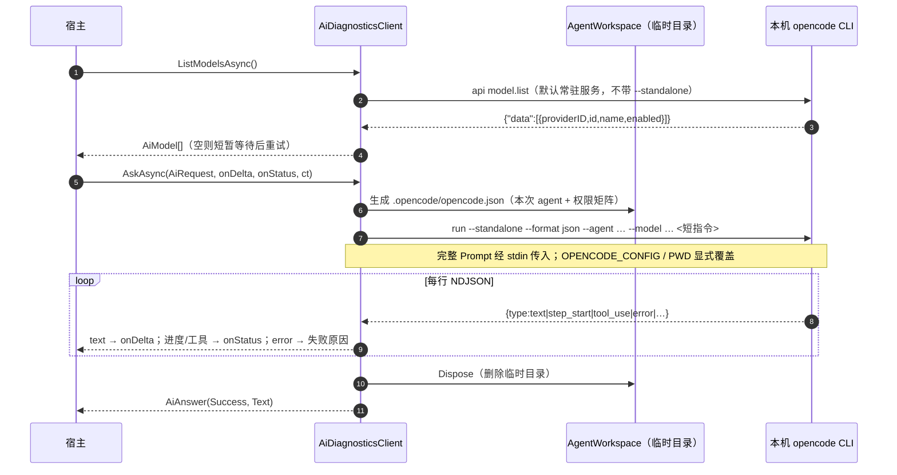

# AiDiagnostics

通过**本机 opencode CLI** 做 AI 诊断的通用 .NET 库：**零 UI 依赖、零业务域假设、零第三方包**，任何 .NET 10 宿主（WinUI / WPF / Avalonia / 控制台 / ASP.NET）都可以直接引用。

典型用途：把一段日志或现象描述交给指定的模型与只读人设，拿回结构化建议，正文增量与状态提示分开流式回调到界面上。

> v3.4 起不再依赖 `dsh-our-free-model` 或其它 OpenAI 兼容本地网关。模型、凭据与可用 provider **全部由用户本机 opencode 配置决定**，本库只负责定位并拉起 CLI。

---

## 1. 它做什么 / 不做什么

**做**：

- 定位本机 `opencode.exe`（npm 全局 `node_modules` → 本地安装目录 → PATH / npm shim）
- `opencode api model.list` 列举模型（默认常驻后台服务；空清单重试规避 provider 异步装载竞态）
- `opencode run --standalone --format json` 单次分析（NDJSON 事件流），完整 prompt 走 stdin
- 每次分析生成**临时 opencode 项目**：只含本次自定义 agent（temperature 0.1、只读权限矩阵），结束即删除
- 正文增量 / 思考状态 / 工具状态**分流回调**，兼容「逐段文本」与「累积全文」两种 NDJSON 语义
- 错误日志**三类化扫描**（Python 解释器 / error / warning）与**指纹归并分组**（数字/路径/UUID/IP/十六进制归一）
- ANSI 转义剥离、命令行参数引用、一次性进程执行（超时/取消/进程树回收）

**不做**：

- 不含任何人设、关键词或提示词文案 —— 全部由宿主注入
- 不含任何 UI 控件；回调发生在后台线程，切线程由宿主负责
- 不安装 opencode、不配置 provider / 凭据、不拉起或回收常驻服务（每次 `run --standalone` 由 CLI 自己管理私有服务）
- 不做 function calling 工具循环 —— 联网查证交回 opencode 原生 `websearch` / `webfetch` 权限
- 不做多模型编排、会话持久化、RAG

---

## 2. 环境要求

| 项 | 要求 |
| --- | --- |
| 运行时 | .NET 10（`net10.0`） |
| 外部依赖 | 本机 `opencode` CLI（用户自行安装，如 `npm i -g @opencode/cli`） |
| 凭据 | 由本机 opencode 配置（可执行 `opencode models` 检查可用模型），本库不接触 Key |
| 平台 | 跨平台（进程 + System.Text.Json，无 P/Invoke） |

CLI 未安装、provider 未配置、冷启动超时都会以可读的 `AiAnswer(false, ...)` 返回，**不会挂起**：`ProcessRunner` 对 stdin 写入、进程退出与输出冲刷统一纳入超时/取消窗口，并强杀进程树。

---

## 3. 快速开始

```bash
dotnet add reference path/to/src/AiDiagnostics/AiDiagnostics.csproj
```

```csharp
using AiDiagnostics;
using AiDiagnostics.Agents;

// 未安装时给宿主一个入口提示（不抛异常）
if (AiDiagnosticsClient.Locate() is null)
{
    Console.Error.WriteLine("请先安装：npm i -g @opencode/cli");
    return;
}

var client = new AiDiagnosticsClient(() => new OpenCodeOptions
{
    // ExecutablePath 留空即自动定位；也可显式钉住某个安装
    ExecutablePath = string.Empty,
    ModelListAttempts = 3,
});

var models = await client.ListModelsAsync();
if (models.Count == 0)
{
    throw new InvalidOperationException("本机 opencode 没有可用模型，请检查 provider 配置（opencode models）");
}

var agent = new AiAgentProfile
{
    Id = "log-analyst",
    Description = "Read-only log analyst.",
    SystemPrompt = "你是只读排障助手。只依据用户提供的文本分析；不读文件、不执行命令；联网查证是可选兜底，整次最多一轮。",
};

var answer = await client.AskAsync(
    new AiRequest
    {
        Prompt = "解释这个报错：ModuleNotFoundError: No module named 'torch'",
        ModelId = models[0].QualifiedId,     // provider/model 复合 id，原样传给 --model
        Agent = agent,
        UseTools = true,                      // 放行 opencode 的 websearch / webfetch
        Title = "日志分析",
    },
    onDelta: Console.Write,                   // 正文增量：宿主直接 Append
    onStatus: s => Console.Error.WriteLine($"[状态] {s}"));

Console.WriteLine(answer.Success ? "" : $"失败：{answer.Text}");
```

### 日志诊断（三类扫描 + 指纹归并）

```csharp
using AiDiagnostics.Logs;

var scan = LogErrorScanner.Scan(logLines, new LogScanOptions
{
    ErrorMarkers = ["ERROR", "Exception", "CRITICAL", "Segmentation fault"],
    WarnMarkers  = ["WARNING"],
    NoiseHints   = ["listening at", "Starting server"],
    MaxBytes     = 12_000,
});

foreach (var g in scan.Groups)
{
    Console.WriteLine($"[{g.Kind}] {g.Title} ×{g.Count}（第 {g.FirstLine}~{g.LastLine} 行）");
}
```

---

## 4. API 速查

### `AiDiagnosticsClient`

| 成员 | 说明 |
| --- | --- |
| `AiDiagnosticsClient(Func<OpenCodeOptions>?, ...)` | 选项工厂每次调用取最新值；另有 `internal` 构造注入 `ICommandRunner`（测试桩） |
| `static string? Locate()` | 定位本机 opencode 可执行文件，未安装返回 `null` |
| `Task<IReadOnlyList<AiModel>> ListModelsAsync(ct)` | 执行 `api model.list`；非零退出码 / 非 JSON 输出抛 `InvalidOperationException`；空清单重试 |
| `Task<AiAnswer> AskAsync(request, onDelta, onStatus, ct)` | NDJSON 流式分析；`onDelta` 收正文片段，`onStatus` 收「模型思考中… / 正在调用 …」 |

### `OpenCodeOptions`

| 属性 | 默认 | 说明 |
| --- | --- | --- |
| `ExecutablePath` | 空 | 留空自动定位；显式赋值可钉住特定安装 |
| `ModelsTimeoutMs` | 60 000 | 模型列举超时（冷启动要拉起后台服务） |
| `ModelListAttempts` | 3 | 空清单重试次数（含首次） |
| `ModelListRetryDelayMs` | 2 000 | 重试间隔 |
| `AnswerTimeoutMs` | 600 000 | 单次分析超时 |

### `AiRequest` / `AiModel` / `AiAgentProfile` / `AiAnswer`

| 类型 | 字段 |
| --- | --- |
| `AiRequest` | `Prompt`（stdin）、`ModelId`（`provider/model`）、`Agent`、`UseTools`、`Title`、`Instruction`（argv 末尾短指令，有中性默认值） |
| `AiModel` | `ModelId`（复合 id）、`DisplayName`、`QualifiedId` |
| `AiAgentProfile` | `Id`（默认 `diagnostics-analyst`）、`Description`、`SystemPrompt` |
| `AiAnswer` | `Success`、`Text` |

### 日志与底层设施

| 成员 | 说明 |
| --- | --- |
| `LogErrorScanner.Scan(lines, LogScanOptions?)` | 先指纹归并、再按「解释器 → error → warning」优先级装填字节预算；返回 `Groups` / `Blocks` / 计数 / `Truncated` |
| `ErrorGrouper.Group(blocks)` | 指纹归一 → `ErrorGroup`（标题、Count、首末行号、代表块） |
| `RunEventParser`（internal） | `ParseLine` 逐行分流 / `ParseAnswer` 整段兜底，共用同一套类型分支 |
| `Runtime.ProcessRunner` / `CommandLine` / `AnsiStripper` | 进程执行、命令行引用、ANSI 剥离；公开给宿主复用 |
| `Runtime.OpenCodeLocator` | 本机 CLI 定位 |

---

## 5. 调用时序



---

## 6. 行为约定（踩坑换来的，改动前请先读）

1. **模型列举必须走常驻服务，不能带 `--standalone`。** 私有服务每次新建，provider 目录要等插件异步装载完才可见，冷启动时 `model.list` 恒为空。常驻服务刚拉起时同样可能未装载完，所以空清单要重试而不是立刻报错。
2. **`run` 保留 `--standalone`。** 其启动流程会等待 provider 就绪，请求可正常到达上游；去掉它会撞回第 1 条的竞态。
3. **`OPENCODE_CONFIG` 与 `PWD` 必须同时覆盖。** opencode v2 用 `process.env.PWD ?? process.cwd()` 解析项目根，父进程遗留的 `PWD` 会让 `WorkingDirectory` 失效，导致找不到本次生成的自定义 agent。
4. **权限矩阵是能力式安全边界。** 日志是不可信文本（可能夹带提示注入），`*` 与 `read` 恒 `deny`；只有 `websearch` / `webfetch` 在 `UseTools=true` 时 `allow`。行为边界（最多一轮联网、素材不当正文）只写在宿主的 system prompt，不在库里重复。
5. **stdin 必须显式重定向并主动关闭。** GUI 宿主继承的 stdin 是无效句柄，且 opencode 在非 TTY 下要读到 EOF 才开工；写入也要纳入同一超时窗口，否则子进程不读管道时会永久阻塞。
6. **不等待「进程结束 + 管道关闭」。** 孙进程可能继承 stdout/stderr 句柄，`WaitForExit(Async)` 都会卡住；进程退出只认 `Process.Exited` 事件，残余输出最多再等 3 秒。
7. **`onDelta` 是正文片段，宿主直接 `Append`。** 片段间由客户端补 `\n\n`；若上游改为「每次回传累积全文」，客户端只派发新增尾部，不会重复。进度/工具/日志行绝不进正文。
8. **失败判定顺序：流内 `error` 事件 > 退出码 > 正文。** 残缺回答 + 明确原因比只有半截正文更有诊断价值；超时/非零退出码一律保留已流出的部分内容。
9. **被截断的 JSON 半行直接丢弃。** 当成正文会把 `{"type":"tex` 写进回答区，完整事件会另起一行重发。

---

## 7. 测试

```bash
dotnet test test/AiDiagnostics.Test/AiDiagnostics.Test.csproj
```

覆盖：模型清单解析与 `enabled`/`status` 过滤、空清单重试与提前收敛、非零退出码/非 JSON 输出、NDJSON 正文拼接与状态分流、累积全文去重、流内 error、非 JSON 行不进正文、超时与部分正文、参数引用、临时 agent 权限矩阵、stdin 与环境变量注入。全部走内存命令桩（`ICommandRunner`），不真的拉起 opencode、不出网。

---

## 8. 在本仓库中的接入方式

本仓库的宿主是 `ComfyUiRocmLauncher`：

- `ComfyUiRocmLauncher.Core/Ai/ComfyUiAiService.cs` —— 门面：把日志 → 分组 → 提示词 → `AskAsync` 组装好，GUI 只依赖它；并暴露 `LocateOpenCode()` 供入口检测
- `ComfyUiRocmLauncher.Core/Ai/ComfyUiDiagnosis.cs` —— 领域画像：agent 人设、ComfyUI/uvicorn 噪声词、三类分组提问组装
- `ComfyUiRocmLauncher.GUI/Helpers/AiDiagnosticsEntry.cs` —— 入口：检测 CLI、未安装时给安装命令、打开分析窗口
- `ComfyUiRocmLauncher.GUI/Views/AiAnalysisDialog.xaml.cs` —— 界面：分组卡片、模型下拉、流式回答、状态栏、复制

新增宿主项目时，只需注入一份领域画像（约 60 行）+ 让本机装好 opencode 即可，通用能力无需重复实现。
